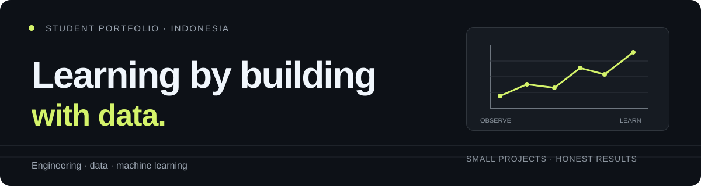

  

## Hi, I'm Vado

I'm a student in Indonesia interested in engineering, data, and machine learning. I learn by trying things, looking closely at the results, and sharing what the work actually shows.

### Selected work

| Project | What you'll find |
| --- | --- |
| [Personal portfolio](https://github.com/R4D3ST0N3/personal-portfolio-site) | A small multi-page site built with HTML, CSS, and JavaScript. |
| [Predict My Salary](https://colab.research.google.com/drive/1g-7BsNwHxDajgNjqvqEuo2ggfZWutv5k?usp=sharing) | An exploration of experience and score data; this notebook does not train a prediction model. |
| [Gender Recognition](https://colab.research.google.com/drive/1TIrKEbPm9v6PAz5Lz60dUWpAJP3hGUTg?usp=sharing) | A look at image labels and a CNN definition; the notebook does not train or evaluate it. |
| [Scam Detector](https://colab.research.google.com/drive/1DdhDHu1FM9u1hnt-fFu9qPcnGT-LyWn4?usp=sharing) | An SMS spam classification experiment with TF-IDF, logistic regression, and a held-out test split. |
| [BMI calculator](https://github.com/R4D3ST0N3/BMI-calculator) | A calculator with metric and imperial height and weight inputs. |

### Tools I've used

**Code:** Python · C# · HTML · CSS · JavaScript  
**Data and prototyping:** Pandas · NumPy · OpenCV · CustomTkinter · Figma · Desmos  
**Creative work:** Filmora · CapCut · After Effects · DaVinci Resolve · OBS Studio

### Outside the code

Guitar and music, calisthenics and team sports, games, stories, and learning Japanese and Mandarin.

[Portfolio repository](https://github.com/R4D3ST0N3/personal-portfolio-site) · [LinkedIn](https://www.linkedin.com/in/raden-mahaghaniyy-367142322/)
